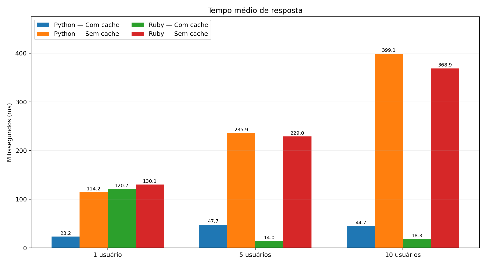
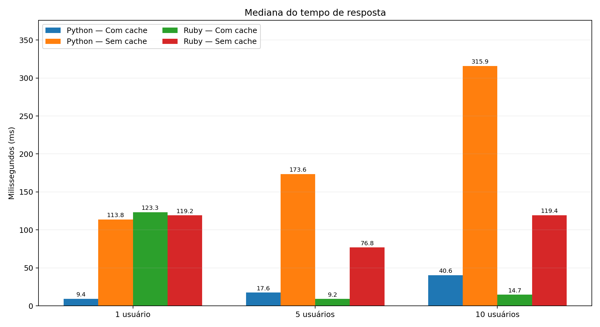
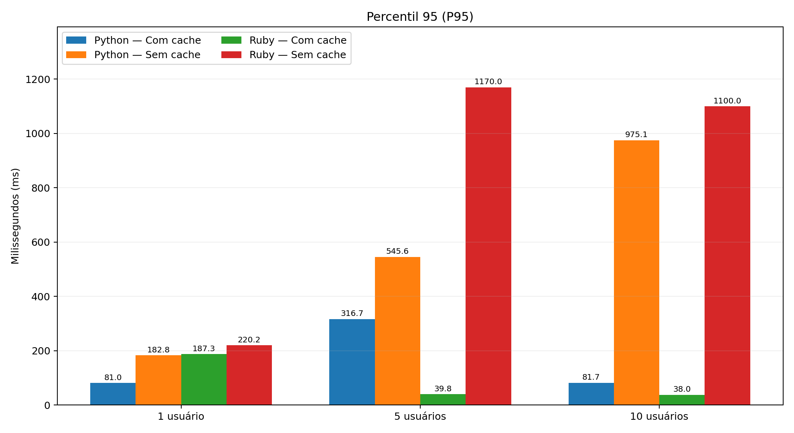
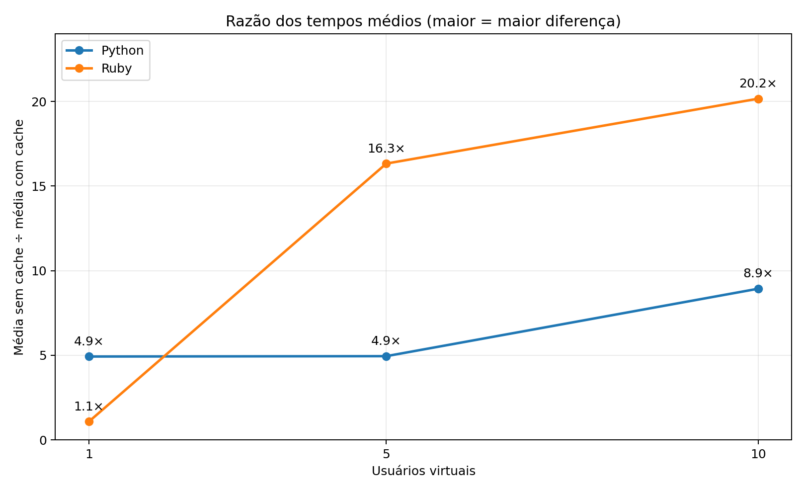

# Relatório de testes de desempenho — Link Extractor

## Objetivo
Comparar as implementações Python e Ruby da API Link Extractor com cache Redis habilitado e desabilitado, sob 1, 5 e 10 usuários virtuais.

## Ambiente e metodologia
- Execução das APIs em contêineres Docker; carga gerada com Grafana k6 executado em contêiner.
- Script `testes-k6/test.js`: 10 páginas do domínio `www.python.org`, acessadas sequencialmente por cada usuário virtual.
- Executor `per-vu-iterations`, uma iteração por usuário; 1, 5 ou 10 usuários, produzindo 10, 50 ou 100 requisições.
- Endpoints locais: Python na porta 5000; Ruby na porta 4567.
- Métricas: média, mediana, P90, P95 e taxa de falhas HTTP. Validação de HTTP 200 e JSON em formato de lista.
- Cache desabilitado por variável de ambiente `CACHE_ENABLED=false`; com cache, o resultado pode ser reutilizado pelo Redis.
- Os valores abaixo correspondem a uma execução por cenário; os relatórios originais do terminal não foram armazenados como arquivos de saída do k6.

## Resultados

| Linguagem | Cache | VUs | Requisições | Média (ms) | Mediana (ms) | P90 (ms) | P95 (ms) | Falhas HTTP |
|---|---|---:|---:|---:|---:|---:|---:|---:|
| Python | Com cache | 1 | 10 | 23.19 | 9.40 | 34.32 | 80.96 | 0% |
| Python | Com cache | 5 | 50 | 47.67 | 17.62 | 123.17 | 316.72 | 0% |
| Python | Com cache | 10 | 100 | 44.68 | 40.56 | 71.32 | 81.68 | 0% |
| Python | Sem cache | 1 | 10 | 114.23 | 113.76 | 176.80 | 182.85 | 0% |
| Python | Sem cache | 5 | 50 | 235.87 | 173.63 | 389.78 | 545.62 | 0% |
| Python | Sem cache | 10 | 100 | 399.14 | 315.85 | 715.63 | 975.12 | 0% |
| Ruby | Com cache | 1 | 10 | 120.71 | 123.31 | 177.87 | 187.30 | 0% |
| Ruby | Com cache | 5 | 50 | 14.02 | 9.21 | 33.56 | 39.84 | 0% |
| Ruby | Com cache | 10 | 100 | 18.29 | 14.71 | 32.11 | 38.05 | 0% |
| Ruby | Sem cache | 1 | 10 | 130.08 | 119.21 | 202.13 | 220.19 | 0% |
| Ruby | Sem cache | 5 | 50 | 228.96 | 76.85 | 418.85 | 1170.00 | 0% |
| Ruby | Sem cache | 10 | 100 | 368.87 | 119.36 | 1050.00 | 1100.00 | 0% |

## Gráficos

## Análise

Em todas as cargas medidas, a média com cache foi menor que a média sem cache para ambas as linguagens. Para 10 usuários, Python apresentou média de 44,68 ms com cache e 399,14 ms sem cache; Ruby, 18,29 ms com cache e 368,87 ms sem cache. Todas as execuções registraram 0% de falhas HTTP.

Os percentis mostram variação relevante de latência. No Ruby sem cache com 10 usuários, por exemplo, P95 foi de 1.100 ms, apesar de a mediana ter sido de 119,36 ms, indicando uma cauda de respostas mais lentas.

## Limitações

Os cenários foram executados apenas uma vez e dependem de páginas externas, sujeitas à variabilidade de rede e do site consultado. O aquecimento do Redis não foi padronizado entre todos os cenários. Portanto, não é possível atribuir diferenças exclusivamente à linguagem ou ao cache, nem inferir significância estatística. Para fortalecer a análise, repetir cada cenário diversas vezes, aquecer o cache de modo controlado e preservar saídas JSON do k6.

## Origem do projeto

Aplicação-base: [ibnesayeed/linkextractor](https://github.com/ibnesayeed/linkextractor). As modificações de testes e alternância de cache foram realizadas para a atividade acadêmica. Preservar a licença e a atribuição do projeto original.
